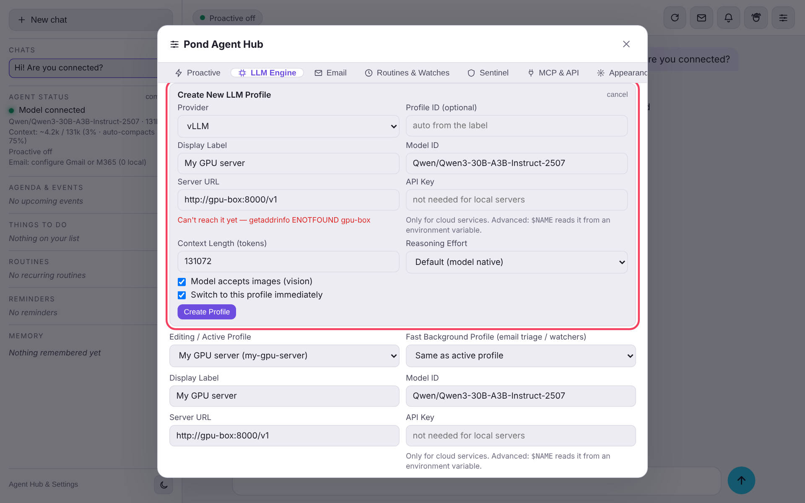

<p align="center">
  
</p>

<h1 align="center">Pond</h1>

<p align="center">
  A proactive personal AI assistant that lives on your own hardware.<br>
  It watches your inbox and calendar, messages you first, and actually gets things done.
</p>

<p align="center">
  <b>Self-hosted</b> · <b>any OpenAI-compatible model (local or cloud)</b> · <b>zero npm dependencies</b> · <b>MIT</b>
</p>

---

Pond is an open-source take on always-on assistants like Meta Muse and OpenAI Dots — but it runs on your
machine, with your model. One Node.js process serves a web app you can install on your phone and desktop.

## What it does

**Proactive by default**
- Watches your email (IMAP, Gmail, Outlook / Microsoft 365) and triages every new message by importance.
- Searches your **whole mailbox history** (Gmail All Mail, every Microsoft 365 folder) — "list my bills / subscriptions".
- Tracks your calendar (`.ics` sync), reminders, to-dos and routines, and gives morning / midday / evening briefings.
- Sends **push notifications** to your phone and desktop — even when the app is closed.
- Knows when to stay quiet: a do-not-disturb window means no "all clear" check-ins with nothing to act on.

**Gets things done**
- Drives a real browser through Microsoft's Playwright MCP server — e.g. "unsubscribe me from these promos".
- Works in your open Blender scenes (Blender 5.1+) through the official Blender Lab MCP server — setup offers it when Blender is installed.
- Looks at images: image files, its own charts, and browser / Blender screenshots (with a vision-capable model).
- Runs Python, reads and writes files, searches the web, schedules recurring routines and watches pages / feeds.
- Every side effect (sending email, running code, external tools…) goes through **Sentinel**, an out-of-band approval gate.

**Rich answers**
- Live **HTML** previews and interactive **3D scenes** (bundled three.js) right in the chat.
- A built-in **`/dashboard`** skill with a consistent, animated chart style in light and dark.
- **Image input** for vision models — paste, drop or pick photos.
- Everything the AI builds is auto-saved, so it can reuse and edit it later.
- **Pond Share** — files the AI makes get a `/share/…` link that opens on your phone too, and a link on its own
  line is shown embedded in the message (pages live, images inline, other files as a card).

**Yours to shape**
- **Skills** — save any workflow ("make my weekly dashboard") and re-run it by typing `/name` (Tab completes the name).
- **Plugins** — extend Pond with a small JavaScript API (tools, events, routes, UI). Example: tokens/second.
  [Write your first plugin in 5 minutes →](docs/plugins.md#your-first-plugin-5-minutes)
- **Personality** — default, casual, concise, playful, or write your own.
- **Appearance** — a cute ink-slime mascot with moods and color themes, or upload your own avatar.

**Built for local models**
- Prompts are kept byte-stable between turns *and across chats* (static system prompt + tools first, per-chat
  state after) so the model server's prefix cache hits; the `toks` plugin shows tok/s and cache-hit % under every reply.
- Big MCP tool sets (e.g. the browser, ~5k tokens) load on demand without changing the tool list, so opening the
  browser deep into a long chat never forces a full re-prefill. Email text sent to the model has tracking links shortened.
- Replies keep running on the server when you switch chats, close the tab or lose signal — reopen and it picks up live.
- Works with Ollama, LM Studio, vLLM, SGLang, llama.cpp — or OpenAI, OpenRouter, DeepSeek and any OpenAI-compatible API.

## Install

**Windows** (PowerShell):

```powershell
irm https://raw.githubusercontent.com/raspy135/pond/main/install.ps1 | iex
```

**macOS / Linux**:

```bash
curl -fsSL https://raw.githubusercontent.com/raspy135/pond/main/install.sh | bash
```

The installer:

1. gets Node.js 18+ if needed (winget / Homebrew / nvm),
2. downloads Pond to `~/pond`,
3. finds a local model server (Ollama, LM Studio, vLLM, llama.cpp) or asks for an API endpoint and lets you pick a model,
4. gets Python 3.9+ if needed and gives Pond its own Python environment (`.venv`) with pandas, matplotlib,
   openpyxl and pypdf — for data, spreadsheets, PDFs and scripts,
5. starts Pond at **http://localhost:8787** (and adds a desktop shortcut on Windows).

### Connect your model

If the installer didn't find your model server, add it in the app: **Agent Hub (⚙️) → LLM Engine → + New Profile**.
Pick your server, and Pond connects and lists its models — local servers need no API key.

<p align="center"></p>

Step-by-step guide with all screenshots, server settings and troubleshooting: **[docs/setup-llm.md](docs/setup-llm.md)**.


**To update, run the same line again** — your `.env` and `data/` are never touched.
Options: `POND_HOME` (install folder), `POND_NO_START=1`, `POND_NONINTERACTIVE=1`.

<details>
<summary>Manual install</summary>

```bash
git clone https://github.com/raspy135/pond && cd pond
node scripts/setup.mjs      # creates .env and picks a model
npm start                   # or start.bat / ./start.sh
```

</details>

## Start, stop, restart

Pond runs as a normal program in a terminal window — while that window is open, Pond is running (checking email,
sending notifications), even if no browser has the app open.

| | Windows | macOS / Linux |
|---|---|---|
| **Start** | Desktop shortcut, or `start.bat` in `~\pond` | `~/pond/start.sh` |
| **Stop** | Close the Pond window (or `Ctrl+C` in it) | `Ctrl+C` in the terminal |
| **Restart** | Stop, then start | Stop, then start |

Restart after **updating** (stop Pond first, then run the install line) or after **editing `.env`**.
Settings changed in Agent Hub apply immediately — no restart needed. Your chats, settings and data are kept.

The computer must stay awake for Pond to work in the background — turn off sleep while plugged in.

<details>
<summary>Start Pond automatically</summary>

**Windows** — at sign-in: press `Win+R`, type `shell:startup`, and put a shortcut to `start.bat` in that folder.

**Linux** (systemd user service):

```bash
mkdir -p ~/.config/systemd/user
cat > ~/.config/systemd/user/pond.service <<'EOF'
[Unit]
Description=Pond
After=network-online.target

[Service]
WorkingDirectory=%h/pond
ExecStart=/usr/bin/env node server.js
Restart=on-failure

[Install]
WantedBy=default.target
EOF
systemctl --user daemon-reload && systemctl --user enable --now pond
loginctl enable-linger "$USER"   # keep running after you log out
```

Then: `systemctl --user restart pond` · `systemctl --user stop pond` · logs: `journalctl --user -u pond -f`.

</details>

> ⚠️ **Pond has no login.** It can read your email and run code, so keep it on `localhost` or a private network
> such as Tailscale. Never forward its port to the internet.

## Use it on your phone

Pond is an installable web app (PWA). Push notifications need HTTPS — the easiest way is
[Tailscale](https://tailscale.com):

```bash
tailscale serve --bg --https=8443 8787
```

Then on your phone open `https://<your-pc>.<tailnet>.ts.net:8443`, **Share → Add to Home Screen**, open Pond from the
home-screen icon, tap 🔔 → **Allow** → **Test push**. Chats, settings and notifications sync across all devices.

## Configure

Most settings live in **Agent Hub** (⚙️ in the app). The basics are in `.env`:

| Variable | What |
|---|---|
| `OPENAI_BASE_URL`, `OPENAI_API_KEY`, `MODEL` | Model endpoint (any OpenAI-compatible server). Local servers accept any key. |
| `PORT` | Web UI port (default 8787) |
| `USER_LOCATION` | Your city, for local suggestions |
| `PROACTIVE_AGGRESSIVENESS` | `low` · `medium` · `high` · `aggressive` |
| `PROACTIVE_DND_HOURS` | Stay quiet unless something is actionable within N hours of the last check-in (default 4) |
| `MAX_TOOL_ROUNDS` | Max tool calls per reply (default 100) |
| `PERSONA`, `PERSONA_CUSTOM` | Personality preset or your own text |
| `MASCOT_PALETTE`, `MASCOT_COLOR` | Mascot color theme |
| `PUSH_CONTACT` | Contact e-mail sent to push services (recommended for iOS) |
| `TAVILY_API_KEY` | Better web search via [Tavily](https://tavily.com) — or paste the key in Agent Hub → MCP & API → Web search |

See [`.env.example`](.env.example) for everything (email, quiet hours, Sentinel, search…).

**Model profiles** — Agent Hub → LLM Engine (guide: [docs/setup-llm.md](docs/setup-llm.md)), stored in `data/llm.json`:
several endpoints, context length, reasoning effort, and `"inputTypes": ["text", "image"]` for vision models.

**Email:** Agent Hub → Email. Use an *app password* for Gmail / iCloud / Yahoo, or connect Microsoft 365.

## Everyday use

| Try | What happens |
|---|---|
| "What needs my attention today?" | Checks email, calendar, reminders and tasks |
| "Every weekday at 8, brief me on my inbox and agenda" | Creates a recurring routine |
| "Unsubscribe me from these promo emails" | Uses the browser to do it (with Sentinel approval) |
| `/dashboard make a weather chart for this week` | Fetches the forecast and builds an animated chart page in Pond's chart style |
| "Make a 3D model of a lighthouse" | Interactive three.js scene in the chat |
| "Save this as a skill" | Saves the workflow; run it later with `/its-name` |
| Paste a photo | Asks about it (vision models) |

## Extend

- **Skills** — `data/skills/<name>/SKILL.md` (+ files). Same layout as Claude / Hermes / OpenClaw skills.
  Built-in skills ship in [`skills/`](skills).
- **Plugins** — `plugins/<id>/plugin.json` + `index.mjs`. Add tools, react to events (`llm_response`, `notification`…),
  expose webhooks, and fill UI slots. Faulty plugins are isolated and auto-disabled. See [docs/plugins.md](docs/plugins.md)
  and the example [`plugins/toks`](plugins/toks).
- **MCP** — connect any Model Context Protocol server (stdio or HTTP) from Agent Hub → MCP.
- **API** — OpenAI-compatible `POST /api/v1/chat/completions` and webhooks at `POST /api/webhooks/<source>`.

## Security model

- **Sentinel** asks before side effects: sending email, running Python / shell, external MCP tools, saving skills,
  changing the personality, plugin tools that declare side effects. Approvals appear outside the chat, so a prompt
  injection can't fake one.
- The AI can't loosen Sentinel rules (e.g. switch a check to "allow") without asking you.
- AI-generated HTML, 3D scenes and uploaded avatars render in **sandboxed iframes** with an opaque origin — they
  can't call Pond's API.
- Plugins run inside Pond: they're protected against *breaking* it, not against being malicious. Only install
  plugins you trust; use MCP servers (separate processes) for untrusted tools.
- Again: **no login** — keep Pond private.

## Architecture

```
server.js            HTTP + SSE server, REST API, webhooks, OpenAI-compatible endpoint
lib/
  llm.js             agent loop, cache-friendly prompts, streaming, vision input
  turns.js           running replies owned by the server (attach / replay from any device)
  share.js           Pond Share folder served at /share/
  tools.js           tool registry (email, calendar, web, files, python, skills, artifacts, MCP, plugins)
  proactive.js       heartbeat, briefings, do-not-disturb, email / event / reminder alerts
  sentinel.js        out-of-band approval gate
  email.js · ms365.js · calendar.js · watchers.js · scheduler.js · web.js · python.js · mcp.js
  push.js            Web Push (VAPID + aes128gcm, zero-dependency)
  skills.js          built-in + user skills
  plugins.js         plugin runtime (API v1)
  htmlcache.js       auto-saved HTML / 3D from chat
  storage.js · config.js · llm-config.js · notifications.js
public/              PWA: app.js, markdown.js (HTML / 3D previews), mascot.js, service worker, vendor/three
skills/              built-in skills (e.g. dashboard)
plugins/             plugins (e.g. toks)
scripts/setup.mjs    first-run setup
install.sh · install.ps1
```

All data is plain JSON under `data/` (git-ignored).

## Development

```bash
npm start          # run
npm run check      # syntax-check every module
npm test           # unit + integration tests (uses a mock model, no API key needed)
```

No build step and no dependencies — edit and reload. On Windows, `rebuild.bat` restarts the server after a syntax check.

## License

[MIT](LICENSE)
