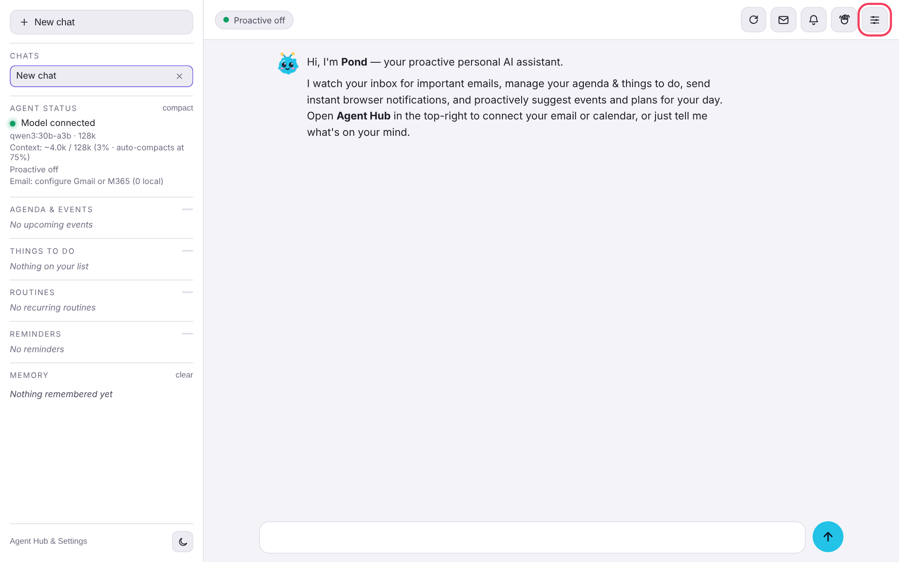
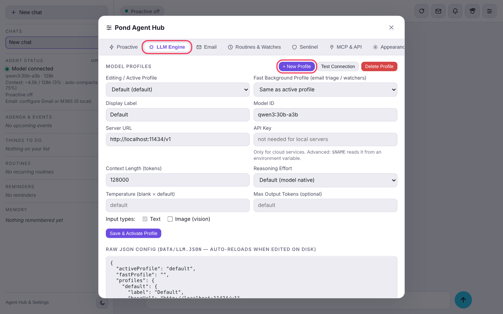
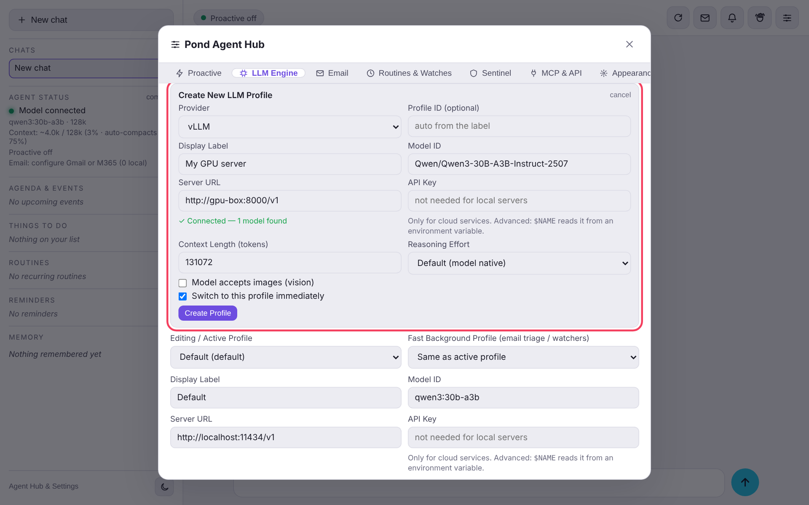
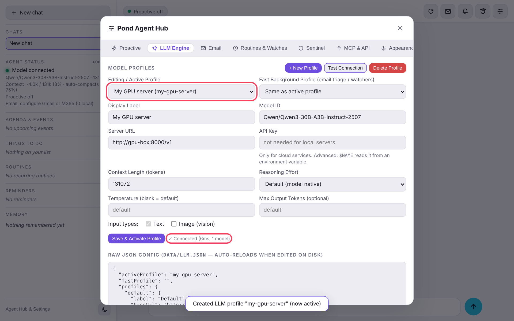
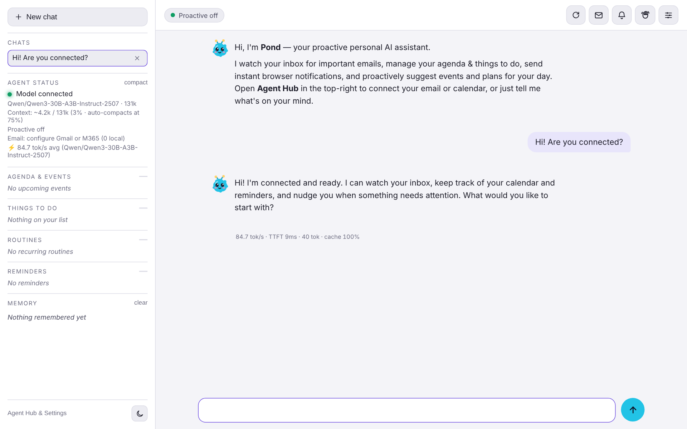

# Connect your model

Pond needs one thing to work: an AI model it can talk to. That can be a server on your own computer or
network (Ollama, LM Studio, vLLM, SGLang, llama.cpp) or a cloud API (OpenAI, OpenRouter, DeepSeek…).
If the installer already found your model server, you can skip this — Pond is ready.

## Before you start

Have your model server running and know its address:

| Server | Default address | Make it reachable from other machines |
|---|---|---|
| Ollama | `http://localhost:11434/v1` | set `OLLAMA_HOST=0.0.0.0` |
| LM Studio | `http://localhost:1234/v1` | Developer tab → *Serve on Local Network* |
| vLLM | `http://localhost:8000/v1` | `--host 0.0.0.0` |
| SGLang | `http://localhost:30000/v1` | `--host 0.0.0.0` |
| llama.cpp | `http://localhost:8080/v1` | `--host 0.0.0.0` |

If the model runs on **another machine** (a GPU box, a DGX Spark…), use that machine's name or IP instead of
`localhost`, e.g. `http://192.168.1.50:8000/v1`.

## 1. Open Agent Hub

Click the settings button in the top-right corner.



## 2. Go to LLM Engine

Open the **LLM Engine** tab and click **+ New Profile**.



## 3. Add your model

1. **Provider** — pick your server. Pond fills in its usual address.
2. **Server URL** — change it if your server is on another machine or port. As soon as Pond can reach the
   server it shows **✓ Connected** and lists the models it serves.
3. **Model ID** — pick one from the list (it's filled in for you if there's only one).
4. **API Key** — leave it empty for local servers. Cloud services need their key.
5. **Context Length** — the context size your server is configured for (e.g. vLLM `--max-model-len`).
6. Tick **Model accepts images** if it's a vision model, so you can paste photos into the chat.
7. Click **Create Profile**.



## 4. Check the connection

The new profile is now active. **Test Connection** should say **✓ Connected**.



## 5. Say hi

Close Agent Hub and send a message. The sidebar shows the model you're using; with the `toks` plugin you also
see speed and cache hits under each reply.



You can keep several profiles (e.g. a big model for chat and a small fast one for **Fast Background Profile**,
which handles email triage and watchers) and switch between them any time.

## Server settings that matter

Pond is an agent: it calls tools (email, calendar, browser…) and sends a fairly long, fixed prompt. Two things
on the server side make a big difference:

- **Tool calling must be on.**
  - vLLM: `--enable-auto-tool-choice --tool-call-parser <parser>` (e.g. `hermes` for Qwen models)
  - SGLang: `--tool-call-parser <parser>` (e.g. `qwen25`)
  - llama.cpp: `--jinja`
  - Ollama / LM Studio: use a model whose page says it supports tools.
- **Enough context.** Use **32k tokens or more**. Ollama's default is much smaller and silently cuts the prompt —
  start it with a larger one (recent versions: `OLLAMA_CONTEXT_LENGTH=32768`). In LM Studio set it when loading the model.

Nice to have:

- **Prefix caching** (on by default in vLLM, SGLang and llama.cpp). Pond keeps the start of every request identical
  so the server can skip re-reading it — replies start much faster.
- **Cache stats** — vLLM `--enable-prompt-tokens-details` lets Pond show how much of each prompt came from cache.

Example — vLLM on a GPU box, reachable from your network:

```bash
vllm serve Qwen/Qwen3-30B-A3B-Instruct-2507 --host 0.0.0.0 --port 8000 \
  --max-model-len 131072 --enable-auto-tool-choice --tool-call-parser hermes \
  --enable-prompt-tokens-details
```

## Troubleshooting

| You see | Usually means |
|---|---|
| *Can't reach it yet* | The server isn't running, the port is wrong, or it only listens on `localhost` (see the table above). Check the firewall on the model machine. |
| `HTTP 404` | The URL is missing `/v1` at the end. |
| `HTTP 401` | The server expects an API key — paste it into **API Key**. |
| *model not found* | The Model ID doesn't match — pick it from the list. |
| Pond answers but never uses tools | Tool calling is off on the server (see above). |
| The first reply after starting Pond is slow | Normal: the server reads Pond's prompt once, then caches it. |

Prefer editing files? Everything on this page is stored in `data/llm.json`, and Pond picks up changes to it
without a restart.
